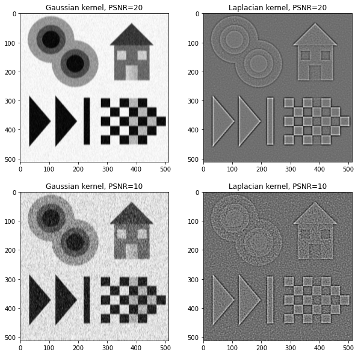
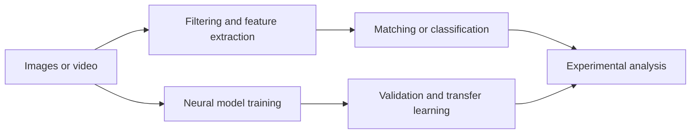

# Image processing and computer vision notebooks

Coursework notebooks covering classical feature extraction, motion estimation and neural image classification. The notebooks contain implementations, experimental outputs and analysis, primarily in Greek.



*An existing output from Lab 1, parts 1–2, comparing Gaussian and Laplacian filtering at PSNR 20 and 10. This figure is extracted from the saved notebook; it is not a new experimental run.*

## Explore the experiments

| Notebook | Focus |
| --- | --- |
| [Lab 1, parts 1–2](lab1-parts1and2-BlaxosGiannis.ipynb) | Edge detection, Harris-style corners, blobs and scale-space methods |
| [Lab 1, part 3](lab1-part3-BlaxosGiannis.ipynb) | Image matching, feature descriptors and image categorization |
| [Lab 2, part 1](lab2-part1_BlaxosIvannhs_03115013.ipynb) | Lucas–Kanade optical flow and face/hand tracking |
| [Lab 2, part 2](lab2-part2.ipynb) | Spatiotemporal features, bag of visual words and action classification |
| [Image-analysis lab](M31_lab2_BlaxosIvannhs.ipynb) | TensorFlow data pipelines, CNNs, training comparisons and transfer learning |

The collection connects hand-designed local features with learned representations and classification pipelines.

## Method overview



## Read and reproduce

GitHub can display the saved notebooks without installing the environment. To inspect them locally:

```bash
python -m pip install jupyterlab
python -m jupyter lab
```

Select a notebook and inspect its setup cells before running it. Dependencies vary: NumPy, Matplotlib, OpenCV, SciPy and scikit-learn for classical vision; TensorFlow and TensorFlow Datasets for the neural experiments; PyTorch in parts of the feature work.

## Reproducibility limits

These notebooks retain their original course context. External images/videos, course helper modules such as `cv20_lab1_part3_utils`, and paths from the original environment may need to be restored. Older TensorFlow, Keras Tuner and other APIs may require adaptation. There is no single locked environment for every notebook.

Saved plots and metrics document earlier runs; they have not been regenerated as a new benchmark. Original assignment text, collaborators and source attributions are retained inside the notebooks.
